  

# 🛠️ Awesome Dotfiles Management & Developer Config Ecosystem 🚀

  <strong>Curated directory of Cloud Development Environments (CDEs), SaaS sandboxes, declarative config managers, and open-source dotfile synchronizers.</strong>

  
  
  
  
  

---

*Focused on Declarative Configuration, Cross-Machine Synchronization, CDE Cloud Workspaces & Self-Hosted Environment Bootstrapping.*  
*Last updated: March 2026* 🌟

---

## 📑 Table of Contents
- [🔍 Sector Overview & Market Dynamics](#-sector-overview--market-dynamics)
- [☁️ SaaS Products & Cloud Developer Platforms](#️-saas-products--cloud-developer-platforms)
- [📦 Open-Source GitHub Projects](#-open-source-github-projects)
  - [🏆 Top Ranked Open-Source Dotfile Tools](#-top-ranked-open-source-dotfile-tools)
  - [✨ Additional Curated Open-Source Tools](#-additional-curated-open-source-tools)
- [💡 How to Choose Your Dotfile Stack](#-how-to-choose-your-dotfile-stack)
- [🤝 How to Contribute](#-how-to-contribute)
- [⚠️ Disclaimer](#️-disclaimer)
- [📈 Star History](#-star-history)
- [💖 Support & Sponsorship](#-support--sponsorship)

---

## 🔍 Sector Overview & Market Dynamics

The global Cloud Development Environment (CDE) and developer workspace synchronization market is estimated at **$7.5 billion in 2026** (growing at an estimated 24% CAGR toward $15B+ by the decade's end), driven by the rapid enterprise shift from localized developer machines to remote cloud sandboxes, AI coding agents, and declarative infrastructure-as-code setups. 

The sector exhibits **moderate fragmentation across specialized tiers**: the hosted cloud developer environment space is moderately concentrated around hyperscaler platforms (notably GitHub/Microsoft), while autonomous AI sandboxing, on-premises enterprise CDEs, and local workstation dotfile managers remain competitive, fragmented, and predominantly community-powered by open-source standards.

---

## ☁️ SaaS Products & Cloud Developer Platforms

The following hosted cloud platforms natively integrate developer dotfiles, automated environment bootstrapping, and personalized shell/editor syncing into cloud-hosted developer environments.

> [!NOTE]
> Platforms are sorted descending by company size (valuation / annual revenue run-rate).

| Company / Product | Company Size (Valuation / Revenue) | Starting Paid Pricing | Free Tier Limits | Primary Dotfile Synchronization Features |
| :--- | :--- | :--- | :--- | :--- |
| **[GitHub Codespaces](https://github.com/features/codespaces)** | **$10B+ Valuation** ($2B+ Annual Revenue Run Rate) | **$0.18/hour** (2 cores, 4GB RAM) + $0.07/GB/mo storage | **120 core-hours + 15 GB storage free per month** for all personal GitHub accounts | Automatically clones user's `dotfiles` repo upon workspace creation; executes `install.sh`, `bootstrap.sh`, or `setup.sh`. |
| **[Daytona](https://www.daytona.io/)** | **$1.0B Valuation** (Series B Unicorn) | **$0.015/hour** ($10/seat/month base for teams) | **$200 free compute credits** (valid for 30 days) on sign-up | Fast ephemeral microVM & container sandboxes with automatic Git dotfiles repository injection and sub-90ms boot. |
| **[Coder](https://coder.com/)** | **~$400M Valuation** (~$50M+ Annual Revenue) | **$20/seat/month** (Enterprise self-hosted annual commitment) | **Free Community Edition (Unlimited self-hosted users & workspaces forever)** on own Kubernetes/VM infrastructure | Terraform-native developer workspaces; automatic user dotfile cloning, custom shell startup scripts, and RBAC policy enforcement. |
| **[Gitpod (Ona)](https://www.gitpod.io/)** | **~$45M Raised** (~$5M Annual Revenue) | **$9/user/month** (Plus compute consumption) | **500 workspace credits/month (~50 free hours forever)** | Zero-config cloud dev environments with declarative `.gitpod.yml`, prebuilds, and automatic personal dotfiles repo linkage. |

---

## 📦 Open-Source GitHub Projects

The dotfile management ecosystem is deeply rooted in open source. Below are the most trusted, battle-tested tools for local and cross-platform workstation configuration, sorted descending by GitHub star counts.

### 🏆 Top Ranked Open-Source Dotfile Tools

| Tool & Repository | GitHub Stars | Core Language / Paradigm | Key Strengths & Dotfile Philosophy |
| :--- | :--- | :--- | :--- |
| **[mathiasbynens/dotfiles](https://github.com/mathiasbynens/dotfiles)** |  | Shell (macOS / Bash / Zsh) | **The gold standard macOS sensible defaults.** Provides foundational configuration scripts for macOS UI, Terminal, Safari, Git, and network optimization. Used as the base for thousands of personal setups. |
| **[twpayne/chezmoi](https://github.com/twpayne/chezmoi)** |  | Go (Single Binary) | **The most feature-complete dotfile manager.** Features Go templating, built-in age/GPG secret encryption, idempotent lifecycle scripts (`run_once_*`, `run_onchange_*`), diff audits, and cross-OS (macOS, Linux, WSL, Windows) drift detection. |
| **[lra/mackup](https://github.com/lra/mackup)** |  | Python | **Application configuration backup and sync.** Backs up application configs (VS Code, SSH, zsh, Sublime, Git) to cloud storage (Dropbox, Google Drive, iCloud, Git) and creates symlinks back automatically. |
| **[webpro/awesome-dotfiles](https://github.com/webpro/awesome-dotfiles)** |  | Markdown / Curated Catalog | **Comprehensive reference index.** Curated repository documenting shell setups, prompt themes, terminal emulators, and configuration frameworks across the developer ecosystem. |
| **[nix-community/home-manager](https://github.com/nix-community/home-manager)** |  | Nix | **Purely declarative user environment management.** Treats your entire `$HOME` directory, user systemd services, and installed packages as atomic, reproducible, rollback-capable Nix derivations. |
| **[anishathalye/dotbot](https://github.com/anishathalye/dotbot)** |  | Python (YAML Spec) | **Clean and lightweight bootstrapper.** Zero external dependencies beyond Python. Reads declarative YAML configuration to symlink configs, execute shell hooks, and create directories. |
| **[holman/dotfiles](https://github.com/holman/dotfiles)** |  | Shell / Ruby | **Pioneering topic-based dotfiles architecture.** Popularized organizing dotfiles by topic directories (`git/`, `zsh/`, `ruby/`) with automated symlink scripts and custom path bindings. |
| **[yadm-dev/yadm](https://github.com/yadm-dev/yadm)** |  | Bash / Git wrapper | **Git-native in-place management.** Uses `$HOME` directly as the Git working tree without requiring symlinks. Includes alternate file selection by hostname/OS and built-in GPG/transcrypt encryption. |
| **[thoughtbot/rcm](https://github.com/thoughtbot/rcm)** |  | Shell (rcup / rcdn) | **Thoughtbot's rc file manager.** Pragmatic suite of commands (`rcup`, `rcdn`, `mkrc`, `lsrc`) for managing multiple dotfile directories, machine tags, and host-specific symlinks. |
| **[technicalpickles/homesick](https://github.com/technicalpickles/homesick)** |  | Ruby | **Castles for your dotfiles.** Clones dotfile repositories as "castles" and generates symlinks into your home directory using Thor and Git. |
| **[deadc0de6/dotdrop](https://github.com/deadc0de6/dotdrop)** |  | Python / Jinja2 | **Template-driven multi-host manager.** Uses Jinja2 templating to share configuration files across multiple different OSes and host profiles from a single centralized repo. |
| **[freshshell/fresh](https://github.com/freshshell/fresh)** |  | Shell | **Composable shell configuration manager.** Build your dotfiles from modular, reusable snippets hosted anywhere on GitHub (e.g., `fresh user/repo config.sh`). |
| **[aspiers/stow](https://github.com/aspiers/stow)** |  | Perl (GNU Stow) | **Battle-tested symlink farm manager.** Organizes configs into distinct package folders and symlinks them cleanly into target directories. Minimal, robust, and zero-abstraction. |
| **[rhysd/dotfiles](https://github.com/rhysd/dotfiles)** |  | Go | **Modern symlink CLI.** Fast, compiled Go CLI designed for linking dotfiles and managing nested dotfile directories with JSON/YAML configurations. |

---

### ✨ Additional Curated Open-Source Tools

- **[comtrya](https://github.com/comtrya/comtrya)** 🦀 — Fast localhost configuration management tool written in Rust for Linux, macOS, BSD, and Windows.
- **[dotsman](https://github.com)** 🐍 — Python-based manager supporting hostname-specific overrides and built-in `age` asymmetric encryption.
- **[dotpilot](https://github.com)** ⚡ — Zero-abstraction manager where the repository strictly mirrors `$HOME` with automated dry-runs and safe backup rolls.
- **[ellipsis](https://github.com)** 📦 — Modular package manager for dotfiles that treats configurations as composable packages.
- **[Pearl](https://github.com)** 🐚 — Lightweight ecosystem package manager for reproducible environments and dotfiles across Linux & macOS.
- **[Gentleman.Dots](https://github.com)** 🎨 — Interactive terminal TUI installer delivering pre-configured modern Neovim, Tmux/Zellij, and shell layouts.

---

## 💡 How to Choose Your Dotfile Stack

| Use Case | Recommended Solution | Why? |
| :--- | :--- | :--- |
| **Heterogeneous Environments** (macOS + Linux + WSL) | **chezmoi** | Go templates dynamically resolve OS/architecture, with integrated `age` encryption for tokens and SSH keys. |
| **Zero Abstraction & In-Place Git** | **yadm** | `$HOME` is directly the Git working tree. No symlinks required. |
| **Minimalist & Unix Philosophy** | **GNU Stow** | Organizes packages by directory (`stow zsh`, `stow nvim`) with zero runtime overhead. |
| **Automated Fresh Machine Bootstrap** | **Dotbot** | Clean YAML directive configuration that runs automatically on a fresh machine via a single shell script. |
| **Pure Reproducibility & Declarative OS** | **Home Manager (Nix)** | Treats configs, binaries, and daemon services as immutable derivations that can be rolled back atomically. |
| **Cloud Workspaces & AI Code Sandboxes** | **GitHub Codespaces / Daytona / Coder** | Automates personal terminal profiles, secrets, and toolchains within isolated remote cloud dev environments. |

---

## 🤝 How to Contribute

Contributions are welcome and highly appreciated! 🎉

1. 🍴 **Fork the repository** on GitHub.
2. 🌿 **Create a new branch** (`git checkout -b feature/cool-new-tool`).
3. 📝 **Add or update entries** following the tabular format (for SaaS: include exact pricing, free tier limits, company size; for Open-Source: add GitHub star badge linking to stargazers).
4. ✅ **Ensure accuracy** and neutral, factual descriptions.
5. 🚀 **Submit a Pull Request** with a descriptive summary of changes.

---

## ⚠️ Disclaimer

- This catalog is a **community-curated guide** intended for informational and educational purposes.
- Dotfile managers handle shell environment scripts, SSH configs, and sensitive credentials. **Never commit unencrypted secrets or API tokens to public Git repositories.** Always utilize asymmetric encryption (`age`, `gpg`) or dedicated secret managers (e.g., 1Password CLI, Bitwarden CLI, Vault).

---

## 📈 Star History

---

## 💖 Support & Sponsorship

Thank you so much for exploring this curated ecosystem! If this repository helped you level up your developer workflow or discover your next configuration framework:

- ⭐ **Star this repository** on GitHub to show your support!
- 🍴 **Fork and share** with colleagues, DevOps teammates, and friends.
- ☕ **Support continuous maintenance & updates**: Buy me a coffee via the [GitHub Sponsor Dashboard](https://github.com/sponsors/ishandutta2007).

---

  Built with ❤️ for developers, DevOps engineers, and power users crafting their digital workspace as code.

